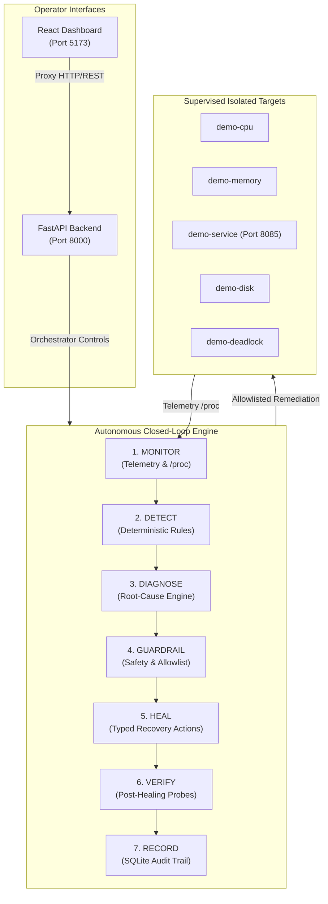

# Autonomous Fault Detection and Self-Healing System for Linux
## Step-by-Step Execution Guide & Runbook

This runbook provides complete, step-by-step instructions for launching, operating, testing, and observing the autonomous self-healing framework, its API backend, interactive web dashboard, and controlled fault-injection subsystem.

---

## Architecture & Interaction Flow



---

## 1. Prerequisites & Environment Setup

The system operates strictly in user space on Linux (Ubuntu 20.04+ recommended).

### 1.1 Activate Python Virtual Environment
A Python virtual environment is pre-configured in the repository root:

```bash
# From repository root
cd /home/kushal/projects/linux-self-healing

# Activate virtual environment
source .venv/bin/activate
```

> [!NOTE]
> If setting up fresh on another machine:
> ```bash
> python3 -m venv .venv
> source .venv/bin/activate
> pip install -e .
> pip install -r requirements-dev.txt
> ```

### 1.2 Frontend Dependencies
If running the operator dashboard, ensure Node.js (v18+) is available and install dependencies:

```bash
cd frontend
npm install
cd ..
```

---

## 2. Health & Configuration Validation

Before running any recovery actions or daemons, confirm system prerequisites and allowlists:

```bash
# Run baseline environmental health probes (Python runtime, /proc, systemd)
python -m self_healing health

# Display and validate configuration parameters and allowlisted targets
python -m self_healing config
```

Expected health status:
```text
OVERALL SYSTEM STATUS: HEALTHY
```

Key configuration references:
* [`config/default_config.yaml`](config/default_config.yaml) — Sampling intervals, thresholds, database paths, and guardrail limits.
* [`config/targets.yaml`](config/targets.yaml) — Strict target allowlist governing permissible demo processes.

---

## 3. Telemetry & Monitoring Snapshot

Capture an instant, read-only telemetry snapshot of host CPU, memory, disks, systemd services, and supervised target processes:

```bash
# Formatted human-readable terminal output:
python -m self_healing monitor

# Machine-readable JSON output (ideal for automation/logging pipelines):
python -m self_healing monitor --json

# Inspect specific systemd service units:
python -m self_healing monitor --service systemd-journald --service cron

# Filter telemetry to a specific target:
python -m self_healing monitor --target demo-service
```

---

## 4. Running the Autonomous Self-Healing Daemon

The orchestrator coordinates the closed-loop cycle:
$$\mathbf{MONITOR} \longrightarrow \mathbf{DETECT} \longrightarrow \mathbf{DIAGNOSE} \longrightarrow \mathbf{GUARDRAIL} \longrightarrow \mathbf{HEAL} \longrightarrow \mathbf{VERIFY}$$

### Option A: Dry-Run Mode (Simulation & Policy Evaluation)
Dry-run mode is enabled by default to ensure safety. Proposed healing actions pass through guardrails, log intent, and simulate post-recovery checks without modifying OS state.

```bash
# Execute a single discrete tick and exit:
python -m self_healing run --dry-run --once

# Run continuous loop with a 2.0-second polling interval:
python -m self_healing run --interval 2.0 --dry-run

# Run a bounded number of ticks (e.g., 10 ticks):
python -m self_healing run --max-ticks 10 --dry-run
```

### Option B: Active Self-Healing Mode
Active mode executes verified remediation commands (e.g., `kill`, `renice`, directory cleanup) against strictly allowlisted demo targets:

```bash
python -m self_healing run --no-dry-run --interval 1.0
```

> [!IMPORTANT]
> The safety guardrail layer strictly prevents recovery actions against system daemons, kernel processes, or non-allowlisted targets.

---

## 5. Running the Web Dashboard & API (Full Stack)

To run the operator control panel and real-time visualization:

### 5.1 Start the FastAPI Backend
Launch the ASGI server in terminal 1:

```bash
source .venv/bin/activate
uvicorn self_healing.api.app:create_app --factory --host 127.0.0.1 --port 8000
```

* **Interactive Swagger UI**: [http://127.0.0.1:8000/docs](http://127.0.0.1:8000/docs)
* **ReDoc Documentation**: [http://127.0.0.1:8000/redoc](http://127.0.0.1:8000/redoc)
* **Health Endpoint**: `GET http://127.0.0.1:8000/health`
* **Incidents Endpoint**: `GET http://127.0.0.1:8000/incidents`

### 5.2 Start the Vite / React Frontend Dashboard
Launch the development server in terminal 2:

```bash
cd frontend
npm run dev
```

* **Dashboard URL**: [http://localhost:5173](http://localhost:5173)

The dashboard provides real-time system resource graphs, supervised target states, active incident alerts, guardrail metrics, and one-click fault injection controls.

---

## 6. Fault Injection & Chaos Testing

The system includes a controlled fault-injection subsystem to test the healing engine against deterministic anomalies in safe demo targets.

### 6.1 Available Fault Scenarios

| Scenario | Target ID | Mechanism | Default Safety Bound |
| :--- | :--- | :--- | :--- |
| **CPU Runaway** | `demo-cpu` | 1-core arithmetic spin loop | Confined to 1 worker thread |
| **Memory Leak** | `demo-memory` | Incremental heap chunk allocation | Hard ceiling capped at 256 MB |
| **Service Crash** | `demo-service` | HTTP server on port 8085 triggered to crash | Bound to `127.0.0.1:8085` |
| **Disk Exhaustion** | `demo-disk` | Scratch log writer | Capped at 50 MB in `demo_scratch/` |
| **Thread Deadlock** | `demo-deadlock` | AB-BA circular lock inversion | Isolated subprocess |

### 6.2 Example: Inducing CPU Runaway & Observing Healing

1. In Terminal 1, run the autonomous daemon:
   ```bash
   python -m self_healing run --no-dry-run --interval 1.0
   ```

2. In Terminal 2, inject a CPU runaway fault:
   ```bash
   python -m self_healing fault cpu start
   ```

3. Check the status of the injected fault:
   ```bash
   python -m self_healing fault status
   ```

4. Observe in Terminal 1 (or the Web Dashboard) how the orchestrator:
   - Detects the CPU runaway via `CpuRunawayDetector`
   - Diagnoses the root cause as `HIGH_CPU`
   - Validates the action via `SafetyGuardrailEngine`
   - Executes remediation (`lower_priority` or `terminate`)
   - Verifies recovery using `VerificationEngine`
   - Records the incident in SQLite (`data/incidents.db`)

5. Clean up any lingering demo processes:
   ```bash
   python -m self_healing fault cleanup
   ```

### 6.3 Command Syntax for All Injectors
Every fault injector supports standard subcommands: `{start|status|stop|cleanup}`:

```bash
# Memory leak:
python -m self_healing fault memory start
python -m self_healing fault memory status
python -m self_healing fault memory stop
python -m self_healing fault memory cleanup

# Deadlock:
python -m self_healing fault deadlock start
python -m self_healing fault deadlock status
python -m self_healing fault deadlock cleanup

# Service crash:
python -m self_healing fault service start
python -m self_healing fault service status
python -m self_healing fault service cleanup

# Global sweep across all demo targets:
python -m self_healing fault cleanup
```

---

## 7. Running Test Suites & Safety Invariants

### 7.1 Complete Pytest Test Suite
Runs all 221 unit, integration, and end-to-end tests:

```bash
./scripts/run_tests.sh
# or directly:
pytest
```

### 7.2 Safety & Robustness Verification
Executes the 15 failure vectors and 6 core safety invariant checks:

```bash
python scripts/run_safety_tests.py
```

### 7.3 Evaluation Framework Benchmarks
Evaluates detection latencies, MTTR, false-positive resistance, and generates comparison plots:

```bash
python scripts/evaluate_framework.py
python scripts/evaluate_anomaly_detection.py
```

---

## 8. Command Cheat Sheet

| Task | Command |
| :--- | :--- |
| **Activate Venv** | `source .venv/bin/activate` |
| **Health Check** | `python -m self_healing health` |
| **Validate Config** | `python -m self_healing config` |
| **Telemetry Snapshot** | `python -m self_healing monitor` |
| **Orchestrator (Dry-Run)** | `python -m self_healing run --dry-run --interval 1.0` |
| **Orchestrator (Active)** | `python -m self_healing run --no-dry-run --interval 1.0` |
| **Backend API** | `uvicorn self_healing.api.app:create_app --factory --host 127.0.0.1 --port 8000` |
| **Frontend UI** | `cd frontend && npm run dev` |
| **Inject CPU Fault** | `python -m self_healing fault cpu start` |
| **Purge Demo Faults** | `python -m self_healing fault cleanup` |
| **Run All Tests** | `./scripts/run_tests.sh` |
| **Run Safety Invariants** | `python scripts/run_safety_tests.py` |
