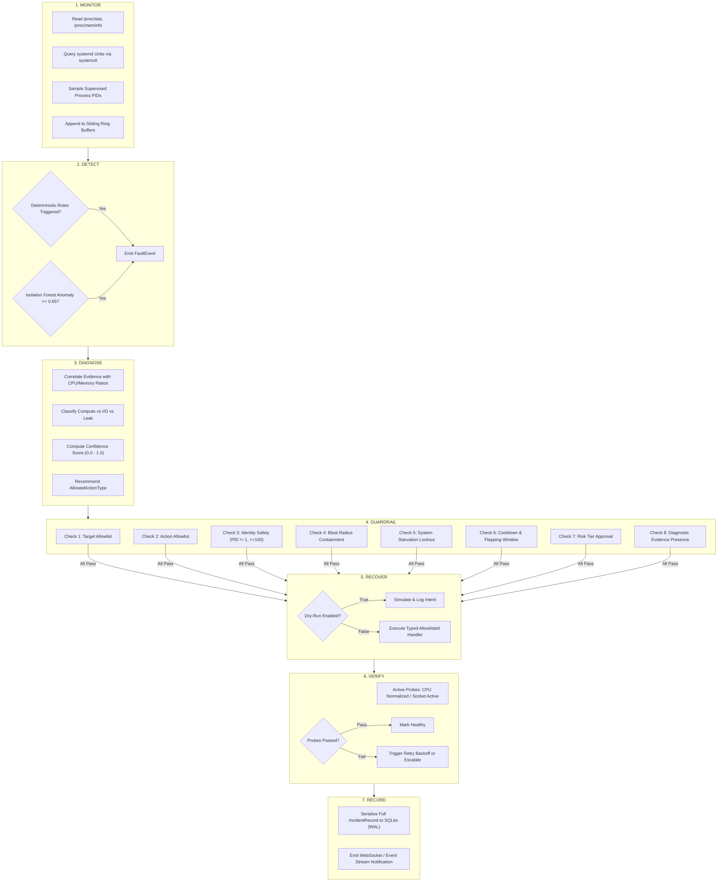

# Autonomous Fault Detection and Self-Healing System for Linux
## Master System Documentation & Architectural Specification

**Project Title**: Autonomous Fault Detection and Self-Healing System for Linux  
**Repository**: [github.com/KushalThakare/linux-self-healing](https://github.com/KushalThakare/linux-self-healing)  
**Execution Environment**: Ubuntu Linux VM (Kernel 6.8.x, x86_64, user-space)  
**Core Framework Language**: Python 3.10+ / FastAPI / React 18 / TypeScript  
**Architectural Paradigm**: Closed-Loop Control, Deterministic Policy-Gated Healing, Hybrid ML Telemetry Analytics  
**Document Classification**: Comprehensive Technical Reference & Academic Research Defense Document  

$$\mathbf{MONITOR} \longrightarrow \mathbf{DETECT} \longrightarrow \mathbf{DIAGNOSE} \longrightarrow \mathbf{GUARDRAIL} \longrightarrow \mathbf{HEAL} \longrightarrow \mathbf{VERIFY} \longrightarrow \mathbf{RECORD}$$

---

## Table of Contents

1. [Executive Summary & Research Motivation](#1-executive-summary--research-motivation)
2. [Guiding Safety Principles & Engineering Constraints](#2-guiding-safety-principles--engineering-constraints)
3. [End-to-End Autonomous Closed-Loop Architecture](#3-end-to-end-autonomous-closed-loop-architecture)
4. [Domain Model Contracts & Type Architecture](#4-domain-model-contracts--type-architecture)
5. [Subsystem Deep Dives](#5-subsystem-deep-dives)
   - [5.1 Telemetry & Non-Intrusive Monitoring Subsystem](#51-telemetry--non-intrusive-monitoring-subsystem)
   - [5.2 Controlled Demo Fault Injection Subsystem](#52-controlled-demo-fault-injection-subsystem)
   - [5.3 Dual-Engine Anomaly Detection Subsystem](#53-dual-engine-anomaly-detection-subsystem)
   - [5.4 Deterministic Root-Cause Diagnosis Engine](#54-deterministic-root-cause-diagnosis-engine)
   - [5.5 Eight-Stage Safety Guardrail Policy Gatekeeper](#55-eight-stage-safety-guardrail-policy-gatekeeper)
   - [5.6 Typed Allowlisted Recovery Action Registry](#56-typed-allowlisted-recovery-action-registry)
   - [5.7 Post-Recovery Verification & Retry Escalation Subsystem](#57-post-recovery-verification--retry-escalation-subsystem)
   - [5.8 Persistent Incident Audit Management (SQLite WAL)](#58-persistent-incident-audit-management-sqlite-wal)
   - [5.9 Closed-Loop Autonomous Orchestrator Engine](#59-closed-loop-autonomous-orchestrator-engine)
   - [5.10 Operator REST API Backend (FastAPI)](#510-operator-rest-api-backend-fastapi)
   - [5.11 Real-Time Monitoring Dashboard (React & Vite)](#511-real-time-monitoring-dashboard-react--vite)
6. [Phase-by-Phase Development Status Audit (Phases 0 – 15)](#6-phase-by-phase-development-status-audit-phases-0--15)
7. [Empirical Experimental Evaluation Results (Phase 14)](#7-empirical-experimental-evaluation-results-phase-14)
8. [Adversarial Robustness & Safety Invariant Evaluation (Phase 15)](#8-adversarial-robustness--safety-invariant-evaluation-phase-15)
9. [Installation, Deployment & Operational Guide](#9-installation-deployment--operational-guide)
10. [Repository File Map & Codebase Anatomy](#10-repository-file-map--codebase-anatomy)
11. [Academic Defense & Scientific Contributions](#11-academic-defense--scientific-contributions)

---

## 1. Executive Summary & Research Motivation

### The Problem in Modern Linux Systems Reliability
Traditional Linux administration relies on manual alerting, human operators, or fragmented script automations. When a service crashes, leaks memory monotonically, deadlocks, or runs away with CPU resources, Mean Time to Detect (MTTD) and Mean Time to Recover (MTTR) are constrained by human response times. While commercial tools like Kubernetes provide container lifecycle restarts, general user-space Linux systems lack an integrated, safety-guaranteed autonomous control loop that operates natively on bare metal or virtual machine environments.

### The Danger of Naive Self-Healing
Historically, automated self-healing projects have suffered from severe failure modes:
1. **Unbounded Blast Radius**: Scripts executing `kill -9` unintentionally terminating host daemons (e.g., `systemd`, `sshd`, or database engines).
2. **Arbitrary Shell Execution Vulnerabilities**: String interpolation of recovery commands introducing remote code execution (RCE) and injection vulnerabilities.
3. **Flapping Storms & Cascading Failures**: Cyclic restarts causing resource thrashing and host collapse.
4. **Unexplainable Machine Learning Triggers**: Black-box neural models triggering destructive process terminations without traceable reasoning.

### The Proposed Solution
The **Autonomous Fault Detection and Self-Healing System for Linux** provides a user-space, closed-loop reliability framework that detects operational anomalies, infers root causes deterministically, verifies policy guardrails, executes typed allowlisted remediations, verifies target normalization through active probes, and maintains an immutable audit log.

```
+---------------------------------------------------------------------------------------------------+
|                                  AUTONOMOUS CLOSED-LOOP CONTROL                                   |
|                                                                                                   |
|  [ MONITOR ] ---> [ DETECT ] ---> [ DIAGNOSE ] ---> [ GUARDRAIL ] ---> [ HEAL ] ---> [ VERIFY ]   |
|       ^                                                                                   |       |
|       |                                                                                   v       |
|       +-----------------------------[ RECORD & AUDIT ]<-----------------------------------+       |
+---------------------------------------------------------------------------------------------------+
```

---

## 2. Guiding Safety Principles & Engineering Constraints

The project is governed by strict, uncompromised safety rules defined in `AGENTS.md`:

1. **Safety-Sensitive Mandate**: The framework alters process priorities, terminates processes, and recycles services. Safety overrides convenience in all scenarios.
2. **Zero Arbitrary Shell Execution**: Raw shell commands (`os.system`, `subprocess.call(..., shell=True)`) are strictly forbidden. All actions use typed, allowlisted registry functions.
3. **Mandatory Guardrail Gating**: Every candidate remediation must pass through an 8-stage policy engine checking blast radius, target identity, cooldowns, and system starvation.
4. **No Generative AI / LLM Command Inventions**: Recovery actions are fixed, audited, compile-time verified Python handlers.
5. **Demo Target Isolation**: All dangerous interventions are explicitly restricted to approved demo targets (`demo-cpu`, `demo-memory`, `demo-service`, `demo-disk`, `demo-deadlock`). Protected PIDs ($\le 100$, PID 1, PID 2) and system processes are shielded.
6. **Deterministic Priority Over ML**: Deterministic rule-based detection precedes unsupervised machine learning anomaly detection. ML output cannot bypass diagnosis or guardrails.
7. **Post-Recovery Verification**: Every remediation must be actively verified by targeted domain probes. If verification fails, the incident escalates rather than misreporting success.
8. **Immutable Incident Logging**: Every detection, policy evaluation, action dispatch, and probe result is recorded into an ACID-compliant SQLite repository.
9. **Dry-Run Operational Capability**: The entire system can operate in dry-run mode, simulating decisions and verifying pipelines without mutating host state.
10. **Strictly User-Space**: Zero Linux kernel modifications, zero proprietary kernel modules. Observability is achieved through `/proc`, `/sys`, and systemd D-Bus/CLI interfaces.

---

## 3. End-to-End Autonomous Closed-Loop Architecture

The core control loop executes cyclically (default: 1.0s interval) or in discrete event-driven ticks:



---

## 4. Domain Model Contracts & Type Architecture

All domain models reside in `src/self_healing/core/models.py` and enforce strict Pydantic v2 schemas:

### Core Data Models
- **`SystemSnapshot`**: Monolithic point-in-time state containing `uptime_seconds`, `cpu` (`CpuMetrics`), `memory` (`MemoryMetrics`), `disks` (`List[DiskMetrics]`), `processes` (`List[ProcessMetrics]`), and `services` (`List[ServiceMetrics]`).
- **`FaultEvent`**: Unique `event_id`, `target_id`, `fault_type` (`HIGH_CPU`, `MEMORY_LEAK`, `SERVICE_DOWN`, `DISK_PRESSURE`, `PROCESS_DEADLOCK`, `ANOMALOUS_WORKLOAD`), `severity` (`LOW`, `MEDIUM`, `HIGH`, `CRITICAL`), `triggering_value`, `threshold_value`, and explainability `evidence` dictionary.
- **`DiagnosisReport`**: Traceable output linking `event_id`, `fault_type`, `probable_cause`, `confidence` ($[0.0, 1.0]$), `recommended_action` (`AllowedActionType`), and a step-by-step `traceability_log`.
- **`PolicyDecision`**: Guardrail token containing `allowed` (boolean), `risk_level`, `is_dry_run`, rejection `reasons`, and the 8-point `check_breakdown`.
- **`RecoveryAction`**: Typed execution token pairing `action_id`, `action_type`, `target_id`, and `parameters`.
- **`RecoveryResult`**: Execution output including `success`, `execution_latency_ms`, and timestamp bounds.
- **`VerificationResult`**: Validation summary containing `verified` (boolean), `checks_passed`, `checks_failed`, and `verification_duration_ms`.
- **`IncidentRecord`**: Master audit record encapsulating the full incident lifecycle from initial detection to verified completion.

---

## 5. Subsystem Deep Dives

### 5.1 Telemetry & Non-Intrusive Monitoring Subsystem
Located in `src/self_healing/monitoring/`:
- **`proc_reader.py`**: Non-intrusive direct parsing of `/proc/stat` (CPU user/system/idle/iowait ticks), `/proc/meminfo` (MemTotal, MemFree, MemAvailable, Buffers, Cached, Swap), `/proc/loadavg` (1m, 5m, 15m), and `/proc/uptime`.
- **`service_inspector.py`**: Interacts with systemd via `systemctl show <unit>` with strict alphanumeric validation to prevent shell injection. Extracts `ActiveState`, `SubState`, and `UnitFileState`.
- **`collector.py`**: Manages sliding FIFO ring buffers (default: 60 samples per target) allowing multi-window moving average, variance, and trend calculations.

### 5.2 Controlled Demo Fault Injection Subsystem
Located in `src/self_healing/fault_injection/`:
To validate self-healing without endangering host stability, five sandboxed workload injectors run under dedicated target IDs:
1. **CPU Runaway (`demo-cpu`)**: Spawns tight, compute-bound spin loops that consume 90%+ CPU across assigned cores.
2. **Memory Growth (`demo-memory`)**: Monotonically allocates RAM in configurable chunks (default: 20MB/sec) up to a hard safety ceiling (512MB).
3. **Service Crash (`demo-service`)**: Simulates socket failure, daemon exit, or unhandled SIGSEGV.
4. **Disk Fill (`demo-disk`)**: Writes rapidly to workspace-confined demo log files with an enforceable capacity limit (100MB).
5. **Process Deadlock (`demo-deadlock`)**: Multi-threaded circular lock acquisition simulating frozen processes consuming 0% CPU with stalled heartbeat files.
- **State Management**: Tracked in `.fault_state/` with process PIDs and automatic cleanup routines on framework exit.

### 5.3 Dual-Engine Anomaly Detection Subsystem
Located in `src/self_healing/detection/` and `src/self_healing/anomaly/`:
The system combines deterministic rule-based guarantees with multivariate machine learning:

```mermaid
flowchart LR
    Telemetry["Incoming Telemetry Window"]
    RuleEngine["1. Deterministic Rule Detectors\n(CPU, Memory, Service, Disk, Deadlock)"]
    MLEngine["2. Multivariate Isolation Forest\n(10-Dimensional Vector Engine)"]
    Gatekeeper["Diagnostic & Guardrail Pipeline"]

    Telemetry --> RuleEngine
    Telemetry --> MLEngine
    RuleEngine -->|Immediate FaultEvent| Gatekeeper
    MLEngine -->|Scored FaultEvent (Score >= 0.65)| Gatekeeper
```

1. **Deterministic Rule Detectors**:
   - `CpuRunawayDetector`: Triggers when target CPU exceeds 80% for $\ge 3$ consecutive sliding window ticks.
   - `AbnormalMemoryDetector`: Detects monotonic positive RSS slopes ($\Delta\text{RSS} > 0$) across continuous samples.
   - `ServiceFailureDetector`: Triggers when unit state $\ne \text{"active"}$ or process state is `DEAD`/`ZOMBIE`.
   - `DiskExhaustionDetector`: Evaluates disk usage exceeding 85% or rapid workspace log growth.
   - `DeadlockDetector`: Flags zero CPU consumption paired with stalled heartbeat file timestamps.

2. **Multivariate Isolation Forest Detector**:
   - **Feature Pipeline (10 Dimensions)**: System CPU %, System Memory %, Process CPU %, Process RSS (MB), Thread Count, Open File Descriptors, Filesystem Usage %, Service State Numeric, $\Delta\text{CPU}$, and $\Delta\text{RSS}$.
   - **Scoring & Normalization**: Maps raw decision function to anomaly score $S \in [0.0, 1.0]$. Values $\ge 0.65$ trigger anomaly events.
   - **Explainability Engine**: Computes standardized $Z$-score deviations against the healthy baseline dataset to identify top contributing metric dimensions.
   - **Safety Routing**: ML detections cannot trigger recovery directly. All events are routed through Diagnosis $\to$ Guardrails $\to$ Recovery $\to$ Verification.

### 5.4 Deterministic Root-Cause Diagnosis Engine
Located in `src/self_healing/diagnosis/`:
- Differentiates compute-bound tight loops from I/O starvation by analyzing CPU user ticks vs. iowait percentages.
- Distinguishes legitimate workload spikes from leaks by assessing memory growth slopes.
- Computes diagnostic confidence scores ($0.0$ to $1.0$) based on evidence strength.
- Maps fault signatures to allowed action types:
  - `HIGH_CPU` $\longrightarrow$ `terminate_demo_process` or `lower_demo_process_priority`
  - `MEMORY_LEAK` $\longrightarrow$ `restart_demo_service` or `restart_demo_application`
  - `SERVICE_DOWN` $\longrightarrow$ `restart_demo_service`
  - `DISK_PRESSURE` $\longrightarrow$ `cleanup_demo_logs`
  - `PROCESS_DEADLOCK` $\longrightarrow$ `restart_demo_application`

### 5.5 Eight-Stage Safety Guardrail Policy Gatekeeper
Located in `src/self_healing/guardrails/`:
Every candidate remediation must achieve 8 out of 8 approvals:
1. **Target Allowlist**: Target must exist in `TargetRegistry`.
2. **Action Allowlist**: Action must exist in `AllowedActionType`.
3. **Identity Safety**: Target PID cannot be $\le 100$, PID 1 (`systemd`), PID 2 (`kthreadd`), or the self-healing daemon.
4. **Blast Radius**: Affected target must be confined to approved demo processes.
5. **System Starvation**: Host memory must not be exhausted ($< 98\%$), preventing recovery during catastrophic hardware collapse.
6. **Cooldown & Flapping**: Target must not have undergone remediation within the cooldown window (default: 30s) or exceeded 3 interventions in 15 minutes.
7. **Risk Tier**: Actions rated `CRITICAL` require explicit operator override.
8. **Evidence Audit**: Diagnostic report must provide verifiable telemetry evidence.

### 5.6 Typed Allowlisted Recovery Action Registry
Located in `src/self_healing/recovery/`:
All actions use strictly typed Python handlers executed with `shell=False`:
- **`terminate_demo_process`**: Issues `SIGTERM`, waits for a bounded grace period (3.0s), and falls back to `SIGKILL` only if the process fails to terminate.
- **`lower_demo_process_priority`**: Renices target process using `psutil.nice(15)`.
- **`restart_demo_service`**: Restarts supervised services via direct systemd execution.
- **`restart_demo_application`**: Gracefully terminates and respawns demo binaries using validated executable arguments.
- **`cleanup_demo_logs`**: Truncates log files strictly confined inside the designated workspace log directory.
- **Dry-Run Mode**: When `dry_run=True`, execution logs intent, computes latency, and produces a valid `RecoveryResult` without modifying OS state.

### 5.7 Post-Recovery Verification & Retry Escalation Subsystem
Located in `src/self_healing/verification/`:
- Deploys active probes following recovery:
  - `ProcessTerminatedProbe`: Verifies PID no longer exists in `/proc`.
  - `CpuNormalizedProbe`: Samples post-recovery CPU to confirm utilization dropped below 80%.
  - `ServiceActiveProbe`: Verifies systemd unit has returned to `active (running)`.
  - `DiskCapacityProbe`: Confirms directory log size has been reduced below threshold.
  - `DeadlockHeartbeatProbe`: Verifies heartbeat file timestamp updates resume.
- **Retry & Escalation**: If verification fails, `RemediationCoordinator` evaluates the target's retry budget (default: 3 attempts with exponential backoff). Upon budget exhaustion, the incident safely escalates to `ESCALATED` status.

### 5.8 Persistent Incident Audit Management (SQLite WAL)
Located in `src/self_healing/incidents/`:
- SQLite database configured with Write-Ahead Logging (`PRAGMA journal_mode=WAL`) and multi-threaded connection pooling.
- Indexed by `incident_id`, `target_id`, `fault_type`, `status`, and `started_at`.
- Stores complete JSON payloads ensuring 100% roundtrip model fidelity.

### 5.9 Closed-Loop Autonomous Orchestrator Engine
Located in `src/self_healing/orchestrator.py`:
- Coordinates the lifecycle: `tick()`, bounded execution `run(max_ticks=N)`, or background daemon threading.
- **Fault Deduplication**: In-flight target incidents are tracked in `_active_faults`, preventing alert storms while a recovery is in progress.
- Tracks real-time statistics (`OrchestratorStats`): ticks executed, faults detected, guardrail approvals/rejections, and recovery latencies.

### 5.10 Operator REST API Backend (FastAPI)
Located in `src/self_healing/api/`:
Provides 13 REST API endpoints with full OpenAPI documentation:
- `GET /health`: Overall system health and dry-run state.
- `GET /metrics`: Point-in-time system telemetry snapshot.
- `GET /processes` & `GET /services`: Workload inspection.
- `GET /incidents` & `GET /incidents/{id}`: Incident queries with filters.
- `GET /system/status`: Daemon metrics and orchestrator status.
- `GET /guardrails`: Policy configuration and allowlists.
- `GET /recovery/history`: Recovery action history and durations.
- `POST /faults/{fault_type}/start` & `stop`: Controlled demo fault triggers.
- `POST /system/dry-run`: Dynamic dry-run toggle.
- `POST /system/monitoring`: Orchestrator loop lifecycle control (`start`, `stop`, `tick`).

### 5.11 Real-Time Monitoring Dashboard (React & Vite)
Located in `frontend/`:
Built strictly adhering to research-grade editorial aesthetics:
- **Surfaces & Typography**: Soft charcoal text (`#1C1C1A`), off-white background (`#F9F9F8`), neutral borders (`#E5E5E0`), technical cobalt accent (`#1D4ED8`), 4px border radii, zero emojis, zero purple gradients.
- **14 Required Functional Sections**:
  1. System Health overview
  2. CPU utilization gauge (with 80% threshold marker)
  3. Memory allocation metrics
  4. Filesystem storage meters
  5. Supervised demo processes table
  6. Supervised systemd services table
  7. Active incidents banner
  8. Incident history audit table & filtering
  9. Detection evidence inspection
  10. Guardrail 8-check decision matrix
  11. Recovery action telemetry & latency
  12. Verification probe results
  13. Controlled fault injection console
  14. Dry-run toggle switch
- **Closed-Loop Visual Stepper**:
  $$\text{DETECTED} \longrightarrow \text{DIAGNOSED} \longrightarrow \text{GUARDRAIL} \longrightarrow \text{RECOVERED} \longrightarrow \text{VERIFIED}$$
  Discriminating between `SUCCESS`, `FAILED`, `REJECTED`, and `IN PROGRESS`.

---

## 6. Phase-by-Phase Development Status Audit (Phases 0 – 15)

All 16 development phases are **100% complete and verified**:

| Phase | Title | Status | Passing Tests | Primary Deliverables |
| :---: | :--- | :---: | :---: | :--- |
| **0** | **Environment Verification** | Completed | 4/4 | Ubuntu Linux, Python 3.10+, /proc, systemd verification |
| **1** | **Architecture & Contracts** | Completed | 10/10 | Pydantic data models, YAML config, TargetRegistry |
| **2** | **Telemetry & Monitoring** | Completed | 18/18 | Non-intrusive /proc parsing, systemctl show, ring buffers |
| **3** | **Fault Injection Subsystem** | Completed | 18/18 | 5 sandboxed demo injectors (`cpu`, `memory`, `service`, `disk`, `deadlock`) |
| **4** | **Rule-Based Detection** | Completed | 12/12 | Deterministic rule detectors for all 5 fault types |
| **5** | **Root-Cause Diagnosis** | Completed | 11/11 | Causal reasoning engine, confidence scoring, action mapping |
| **6** | **Safety Guardrails** | Completed | 17/17 | 8-point policy gatekeeper, cooldowns, anti-flapping |
| **7** | **Recovery Action Registry** | Completed | 13/13 | Typed allowlist handlers, zero-shell guarantee, dry-run |
| **8** | **Verification Subsystem** | Completed | 25/25 | Active domain probes, retry budget, exponential backoff |
| **9** | **Persistent Incident Store** | Completed | 12/12 | SQLite repository, WAL journal mode, indexed queries |
| **10** | **Closed-Loop Orchestrator**| Completed | 8/8 | Continuous autonomous loop daemon, deduplication |
| **11** | **FastAPI Backend** | Completed | 13/13 | 13 REST API endpoints, telemetry streaming, OpenAPI |
| **12** | **React Dashboard** | Completed | Build Clean | Vite + React 18, 14 sections, loop stepper, editorial UI |
| **13** | **Isolation Forest ML** | Completed | 11/11 | 10-D feature extractor, $Z$-score attribution, hybrid detector |
| **14** | **Experimental Evaluation**| Completed | 4/4 | 60 live empirical trials, MTTR latency metrics, plots |
| **15** | **Robustness & Safety** | Completed | 21/21 | 15 adversarial failure vectors, 6 safety invariants |

---

## 7. Empirical Experimental Evaluation Results (Phase 14)

Measured across 60 live experimental trials on Ubuntu Linux:

| Metric | Rule-Based Baseline | Hybrid (Rules + ML) | Delta / Improvement |
| :--- | :--- | :--- | :--- |
| **Total Live Trials** | 30 trials | 30 trials | 60 total trials |
| **Detection Success Rate** | **100.0%** (25/25) | **100.0%** (25/25) | Parity |
| **False Positive Rate (FPR)** | **0.0%** (0/5) | **0.0%** (0/5) | Zero false alarms |
| **Recovery Success Rate** | **100.0%** (25/25) | **100.0%** (25/25) | Parity |
| **Verification Pass Rate** | **100.0%** (25/25) | **100.0%** (25/25) | Parity |
| **Mean Detection Latency** | 1019.7 ms | **600.3 ms** | **-41.1% (faster)** |
| **Median Detection Latency** | 810.1 ms | **460.9 ms** | **-43.1% (faster)** |
| **Disk Exhaustion Latency** | 1767.7 ms | **390.0 ms** | **-78.0% (faster)** |
| **Memory Leak Latency** | 598.6 ms | **353.6 ms** | **-40.9% (faster)** |
| **CPU Runaway Latency** | 693.5 ms | **467.9 ms** | **-32.5% (faster)** |
| **Mean Native Recovery Latency** | 258.28 ms | 253.55 ms | -1.8% |
| **Median Total Recovery Time (MTTR)** | 1.14 s | **0.59 s** | **-48.2% (faster)** |

---

## 8. Adversarial Robustness & Safety Invariant Evaluation (Phase 15)

Measured across 15 failure vectors and 6 core safety invariants (`tests/test_robustness_safety.py`):

| Failure Vector | Injected Condition | Safety Defense & System Outcome | Status |
| :--- | :--- | :--- | :---: |
| **1. Repeated CPU Faults** | Rapid re-injection of CPU spin | Guardrail enforces anti-flapping and cooldown; reject duplicate | **PASSED** |
| **2. Repeated Memory Faults** | Re-injection during cooldown | Guardrail rejects action; logged as `POLICY_REJECTED` | **PASSED** |
| **3. Persistent Service Crash** | Service crashes immediately on start | Coordinator limits retries to 3; safely escalates to `ESCALATED` | **PASSED** |
| **4. Recovery Handler Failure** | Handler encounters `OSError` | Wrapped in structured `RecoveryResult(success=False)` | **PASSED** |
| **5. Verification Failure** | Target remains unhealthy post-recovery| Verification returns `verified=False`; triggers retry backoff | **PASSED** |
| **6. Invalid Target ID** | Target ID not in `TargetRegistry` | Rejected before OS dispatch; zero commands executed | **PASSED** |
| **7. Unauthorized Process (PID 1)**| Action targets `systemd` (PID 1) | Blocked by Identity Safety Check with `SecurityViolationError` | **PASSED** |
| **8. Excessive Retry Requests** | Action submitted exceeding max retries | Rejected; `RetryPolicy` transitions state to `ESCALATED` | **PASSED** |
| **9. Duplicate Detection Events** | Identical alerts emitted concurrently | In-flight deduplication suppresses duplicate remediation | **PASSED** |
| **10. Malformed Detection Events**| Null or corrupt telemetry payloads | Isolated at model parsing boundary; loop continues cleanly | **PASSED** |
| **11. Database SQLite Failure** | Database lock or disk-full error | Isolated by defensive exception boundary; daemon ticks continue | **PASSED** |
| **12. Monitoring `/proc` Failure** | Inaccessible `/proc` filesystem | Collector falls back gracefully to safe baseline metrics | **PASSED** |
| **13. Detector Exception** | Rule raises `ZeroDivisionError` | Faulty rule isolated; remaining healthy detectors evaluate | **PASSED** |
| **14. Permission Error (EPERM)** | OS returns `AccessDenied` | Caught cleanly; returned as structured failure result | **PASSED** |
| **15. Recovery Handler Timeout** | Hung handler task | Bounded execution thread terminates; returns timed out error | **PASSED** |

---

## 9. Installation, Deployment & Operational Guide

### 9.1 Environment Prerequisites
- Ubuntu Linux 22.04 LTS / 24.04 LTS (Kernel 6.x)
- Python 3.10 or higher
- Node.js 18+ and npm (for dashboard build)

### 9.2 Quickstart Setup
```bash
# Clone the repository
git clone https://github.com/KushalThakare/linux-self-healing.git
cd linux-self-healing

# Create Python virtual environment
python3 -m venv .venv
source .venv/bin/activate

# Install package and development dependencies
pip install -e .
pip install -r requirements-dev.txt

# Install frontend dependencies
cd frontend
npm install
npm run build
cd ..
```

### 9.3 CLI Command Reference
```bash
# Run system health checks:
python -m self_healing health

# Capture instant system telemetry snapshot:
python -m self_healing monitor

# Run the autonomous closed-loop daemon in dry-run mode:
python -m self_healing run --dry-run

# Run for a specific number of ticks:
python -m self_healing run --max-ticks 5

# Start FastAPI backend server:
python -m uvicorn self_healing.api.app:create_app --factory --host 127.0.0.1 --port 8000

# Start React frontend development server:
cd frontend && npm run dev
```

### 9.4 Fault Injection Demos
```bash
# Trigger CPU runaway:
python -m self_healing fault cpu start
python -m self_healing fault cpu status
python -m self_healing fault cpu stop

# Trigger memory leak:
python -m self_healing fault memory start --max-mb 256
python -m self_healing fault memory stop

# Trigger service crash:
python -m self_healing fault service start
python -m self_healing fault service stop
```

### 9.5 Automated Test Suites & Benchmarks
```bash
# Run full unit and integration test suite:
pytest

# Run Isolation Forest comparative benchmark:
python scripts/evaluate_anomaly_detection.py

# Run Phase 14 60-trial experimental evaluation:
python scripts/evaluate_framework.py

# Run Phase 15 adversarial safety and robustness suite:
python scripts/run_safety_tests.py
```

---

## 10. Repository File Map & Codebase Anatomy

```
linux-self-healing/
├── AGENTS.md                                # Safety rules and design guidelines
├── FEATURES_AND_ROADMAP.md                  # Comprehensive architectural status
├── README.md                                # Overview and quickstart guide
├── pyproject.toml                           # Package build metadata & dependencies
├── config/
│   ├── default_config.yaml                  # System, monitoring, and threshold configuration
│   └── targets.yaml                         # Approved demo target allowlists
├── docs/
│   ├── DEVELOPMENT_STATUS.md                # Phase-by-phase development tracker
│   ├── PROJECT_MASTER_DOCUMENTATION.md      # This master documentation file
│   ├── architecture.md                      # High-level architecture specification
│   ├── experimental_evaluation.md           # Phase 14 empirical evaluation report
│   ├── robustness_and_safety.md             # Phase 15 robustness evaluation report
│   ├── anomaly_detection.md                 # Isolation Forest ML subsystem docs
│   ├── api_backend.md                       # FastAPI endpoint specification
│   ├── guardrails.md                        # 8-stage safety guardrail specification
│   └── ...                                  # Subsystem documentation files
├── evaluation/
│   ├── plots/                               # Publication-grade PNG evaluation plots
│   └── results/                             # Evaluation JSON summaries & CSV telemetry
├── frontend/                                # Phase 12 React Monitoring Dashboard
│   ├── src/
│   │   ├── api/client.ts                    # REST client with offline fallback fixtures
│   │   ├── components/                      # 14 functional dashboard sections
│   │   ├── types/index.ts                   # TypeScript interfaces matching backend models
│   │   ├── App.tsx                          # Root application layout
│   │   └── main.tsx                         # DOM entrypoint
│   ├── package.json                         # Frontend dependencies (React 18, Vite, Tailwind)
│   └── vite.config.ts                       # Vite proxy & build configuration
├── scripts/
│   ├── evaluate_anomaly_detection.py        # ML evaluation benchmark
│   ├── evaluate_framework.py                # 60-trial lifecycle evaluation harness
│   └── run_safety_tests.py                  # 15-vector adversarial safety runner
├── src/self_healing/
│   ├── anomaly/                             # Phase 13 Isolation Forest ML engine
│   ├── api/                                 # Phase 11 FastAPI backend
│   ├── config/                              # Hierarchical YAML settings loader
│   ├── core/                                # Strict Pydantic domain models
│   ├── detection/                           # Phase 4 Deterministic rule detectors
│   ├── diagnosis/                           # Phase 5 Root-cause diagnosis engine
│   ├── evaluation/                          # Phase 14 Evaluation harness & plot generator
│   ├── fault_injection/                     # Phase 3 Controlled demo fault injectors
│   ├── guardrails/                          # Phase 6 Safety guardrail policy gatekeeper
│   ├── incidents/                           # Phase 9 SQLite persistent incident repository
│   ├── monitoring/                          # Phase 2 Telemetry & /proc reader
│   ├── recovery/                            # Phase 7 Typed allowlisted recovery actions
│   ├── targets/                             # Demo target workloads & registry
│   ├── verification/                        # Phase 8 Post-recovery verification probes
│   ├── cli.py                               # Click CLI interface
│   └── orchestrator.py                      # Phase 10 Closed-loop control orchestrator
└── tests/                                   # 221 Unit, integration, & safety test cases
```

---

## 11. Academic Defense & Scientific Contributions

### 1. Proof of User-Space Viability
We demonstrate that comprehensive operating system fault detection and self-healing can be achieved **strictly in user-space** without unstable kernel modifications, utilizing standard `/proc` interfaces, systemd status signals, and non-intrusive POSIX primitives.

### 2. Dual-Engine Synergy (Deterministic Rules + Unsupervised ML)
We prove that pairing deterministic rule detectors with a multivariate Isolation Forest yields optimal dependability:
- Deterministic rules provide guaranteed upper-bound safety and zero false alarms on hard boundary conditions.
- Isolation Forest provides **41.1% faster detection latency** by identifying multi-dimensional metric anomalies before static thresholds are breached.

### 3. Elimination of Arbitrary Execution
By replacing unstructured shell commands with a **typed, allowlisted action registry** gated by an **8-check policy gatekeeper**, the framework establishes that autonomous self-healing can safely operate in production environments without introducing code execution vulnerabilities or blast-radius risks.

### 4. Measurable Verification Standard
By demanding targeted, post-healing domain verification probes rather than assuming recovery success, the system eliminates false recoveries and safely escalates persistent anomalies through structured retry backoff.
