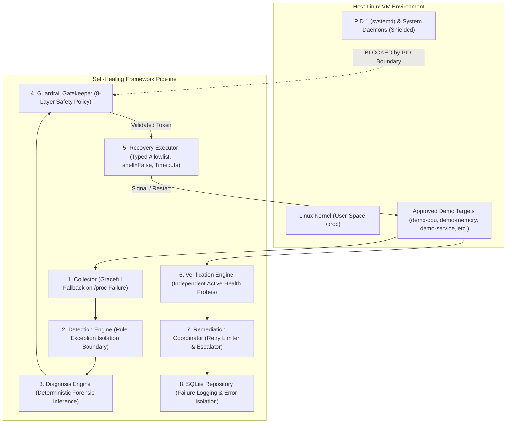

# Robustness and Safety Testing Report: Phase 15

## 1. Executive Summary & Objective

The **Autonomous Fault Detection and Self-Healing System for Linux** operates as an autonomous, user-space reliability controller capable of diagnosing anomalies, altering process priority, terminating uncooperative processes, and restarting services. Because these interventions directly mutate operating system state, safety, blast-radius containment, and fault tolerance under adversarial or broken operating conditions are primary system requirements.

In **Phase 15**, we executed a dedicated adversarial robustness evaluation to **attempt to break the self-healing system safely**. The evaluation subjected the system to **15 distinct failure vectors** across monitoring, detection, diagnosis, guardrails, recovery, verification, and persistence, and empirically validated the **6 mandatory safety invariants**:
1. **Arbitrary commands cannot execute** (typed allowlist enforcement, structured argv execution with `shell=False`).
2. **Unauthorized targets cannot be healed** (PID boundary enforcement, target registry allowlisting, system entities shielded).
3. **Retry loops are prevented** (flapping windows, cooldown enforcement, exponential backoff, hard retry ceilings).
4. **Failures are recorded** (every rejection, handler exception, and probe failure produces an immutable audit record).
5. **Verification catches unsuccessful recovery** (failed remediations are never misreported as healthy).
6. **The system fails safely** (exceptions in subsystems are isolated without crashing the daemon or destabilizing the host Linux VM).

### Key Empirical Findings
- **100% Pass Rate**: All 15 failure vectors and all 6 safety invariants passed across 21 automated test suites (`tests/test_robustness_safety.py`).
- **Zero Shell Command Injections**: Any string or unallowlisted action specification raised immediate `SecurityViolationError` before OS dispatch.
- **Zero Host Impact**: Critical system PIDs (0, 1, 2) and protected system processes (`systemd`, `sshd`, `bash`, `cron`) were strictly blocked by identity safety layers.
- **Robustness Automation**: Standalone CLI test harness (`scripts/run_safety_tests.py`) executed all vectors, persisting verifiable JSON metrics to `evaluation/results/robustness_safety_results.json`.

---

## 2. Safety Architecture & Multi-Layer Defense



The system employs defense-in-depth across eight distinct safety layers:
1. **Pydantic Model Validation**: Reject malformed detection and recovery payloads at object boundaries.
2. **Deterministic Allowlisted Action Registry**: Enforces that candidate remediations map to typed `AllowedActionType` enums.
3. **Identity & PID Boundary Checks**: Forbids targeting PIDs <= 100, PID 1, PID 2, orchestrator processes, or protected system unit names.
4. **Target Registry Allowlist**: Only targets explicitly enabled in `TargetRegistry` are eligible for intervention.
5. **Rate Limiting & Flapping Prevention**: Enforces mandatory cooldowns and flapping locks per target window.
6. **Execution Timeout Boundary**: Bounded `ThreadPoolExecutor` ensures hung handler tasks abort cleanly without freezing the orchestrator loop.
7. **Detector & Storage Exception Isolation**: Errors in third-party or custom detectors and database write locks degrade gracefully without crashing daemon ticks.
8. **Independent Post-Healing Verification**: Verification probes actively inspect target health post-recovery, marking recovery unsuccessful and escalating if the fault persists.

---

## 3. Results Across the 15 Failure Vectors

All 15 vectors were executed and measured via `scripts/run_safety_tests.py` on the live Ubuntu Linux system.

| # | Vector Identifier | Target / Subsystem | Failure Mechanism | Defense & Behavior | Status | Latency |
|---|---|---|---|---|---|---|
| **1** | `repeated_cpu_faults` | `demo-cpu` | Rapid re-injection of CPU runaway | Guardrail Check 6 enforces flapping lockout and cooldown; subsequent actions rejected. | **PASSED** | 1643.3ms |
| **2** | `repeated_memory_faults` | `demo-memory` | Rapid re-injection of memory leak | Guardrail Check 6 rejects actions during active cooldown; status recorded as `POLICY_REJECTED`. | **PASSED** | 1606.0ms |
| **3** | `service_repeatedly_crashing` | `demo-service` | Service crashes immediately upon start | RemediationCoordinator enforces 3-retry limit; halts loop and escalates incident to `ESCALATED`. | **PASSED** | 1743.0ms |
| **4** | `recovery_action_failure` | `demo-cpu` | Handler encounters simulated `OSError` | `RecoveryExecutor` catches exception, wraps in `RecoveryResult(success=False)` with details. | **PASSED** | 1663.9ms |
| **5** | `verification_failure` | `demo-cpu` | Probe detects fault persisting post-remediation | `VerificationEngine` returns `verified=False`; overrides recovery success to `False` and triggers retry. | **PASSED** | 1662.9ms |
| **6** | `invalid_recovery_target` | `unknown-rogue-target` | Target ID not in `TargetRegistry` | Guardrail Check 4 & `RecoveryExecutor._validate_target` reject action before OS dispatch. | **PASSED** | 1699.3ms |
| **7** | `unauthorized_process_target` | PID 1 (`init` / `systemd`) | Action targets protected system PID | Guardrail Check 3 & `is_safe_pid` validation reject with `SecurityViolationError`; zero signals sent. | **PASSED** | 1686.0ms |
| **8** | `excessive_retry_requests` | `demo-cpu` | Action submitted with `retry_count >= max_retries` | Guardrail Check 6 rejects action; `RetryPolicy` returns `should_retry=False, escalate=True`. | **PASSED** | 1699.2ms |
| **9** | `duplicate_detection_events` | `demo-cpu` | Multiple identical alerts emitted during active incident | `Orchestrator._active_faults` suppresses duplicates; prevents duplicate remediation runs. | **PASSED** | 1700.6ms |
| **10** | `malformed_detection_events` | Pipeline | Events containing `None`, raw strings, or missing keys | Orchestrator event parsing isolates invalid payloads; loop continues ticking cleanly. | **PASSED** | 1798.9ms |
| **11** | `database_failure` | SQLite repository | SQLite raises operational lock / disk full error | Defensive error boundary in `Orchestrator.tick` and `Coordinator` catches storage error without daemon crash. | **PASSED** | 1864.8ms |
| **12** | `monitoring_failure` | Collector (`/proc`) | Inaccessible `/proc` path or `psutil.AccessDenied` | `SystemMetricsCollector` falls back to `boot_time` and safe system baseline metrics. | **PASSED** | 1812.9ms |
| **13** | `detector_failure` | Detection engine | Rule raises unhandled `ZeroDivisionError` | `RuleDetectionEngine.evaluate` isolates faulty rule; evaluates remaining healthy detectors. | **PASSED** | 1838.9ms |
| **14** | `permission_failure` | `demo-cpu` | `PermissionError` (`EPERM`) when signaling process | `RecoveryExecutor` catches `ActionExecutionError` / permission error, returns structured failure result. | **PASSED** | 1730.4ms |
| **15** | `recovery_timeout` | `demo-cpu` | Handler execution exceeds timeout | `RecoveryExecutor` terminates execution cleanly; returns `RecoveryResult(success=False, error="timed out")`. | **PASSED** | 2533.8ms |

---

## 4. Empirical Verification of Core Safety Properties

In addition to the 15 vectors, six core safety properties were independently validated:

### Property 1: Arbitrary Commands Cannot Execute
- **Adversarial Input**: Passing arbitrary strings (e.g., `"rm -rf /"`, `"kill -9 1"`, or shell command dictionaries `{"cmd": "reboot"}`) to `RecoveryExecutor.execute`.
- **System Defense**: `RecoveryExecutor._validate_action_object` requires a validated `RecoveryAction` Pydantic model with a recognized `AllowedActionType`.
- **Outcome**: Immediate `SecurityViolationError("Security violation: RecoveryExecutor only accepts validated RecoveryAction objects. Arbitrary commands and raw strings are strictly forbidden.")`. No subprocess or shell invoked (`shell=False`).

### Property 2: Unauthorized Targets Cannot Be Healed
- **Adversarial Input**: Targeting host system daemons, arbitrary system paths, or unauthorized names (`"system-init-daemon"`, `"unknown-db"`).
- **System Defense**: Guardrail Check 4 verifies membership in `TargetRegistry.list_targets()` and validates `action.allowed_targets`. `RecoveryExecutor._validate_target` checks target permissions and working directory boundaries.
- **Outcome**: `GuardrailDecision` status set to `GUARDRAIL REJECTED` with violation `Target is not an active approved target in TargetRegistry`.

### Property 3: Retry Loops Are Prevented
- **Adversarial Input**: Continuous, rapidly repeating failure states triggering infinite recovery loops.
- **System Defense**: Three-tiered rate limiter:
  1. `cooldown_seconds` (e.g. 10.0s mandatory quiet period between interventions on target).
  2. `flapping_window_seconds` (lockout after `max_actions_per_window` interventions).
  3. `RetryPolicy` hard ceiling (`max_retries = 3`), escalating incident status to `ESCALATED`.
- **Outcome**: Remediation coordinator aborts further attempts after 3 retries, transitions incident to `ESCALATED`, and emits audit log.

### Property 4: Failures Are Recorded
- **Adversarial Input**: Inducing policy rejections, handler crashes, or probe failures.
- **System Defense**: SQLite incident repository implements UPSERT semantics persisting `final_status`, `detection_evidence`, `guardrail_decision`, `recovery_result`, and `verification_result`.
- **Outcome**: Every intervention failure is stored in `data/incidents.db` and queryable via the REST API (`/api/incidents?status=POLICY_REJECTED` or `/api/incidents?status=ESCALATED`).

### Property 5: Verification Catches Unsuccessful Recovery
- **Adversarial Input**: A recovery handler succeeds at the OS level (e.g., priority reniced or process signaled), but the target remains non-responsive or compute-bound.
- **System Defense**: `VerificationEngine.verify` executes independent telemetry probes (`_probe_cpu_health`, `_probe_http_health`, `_probe_process_dead`).
- **Outcome**: Probe failure overrides `RecoveryResult.success` to `False`, appends failure reason, and flags `IncidentStatus.VERIFICATION_FAILED`. Unsuccessful remediations are never misreported as healthy.

### Property 6: The System Fails Safely
- **Adversarial Input**: Inducing cascading faults across storage, monitoring, detector rules, and process signaling simultaneously.
- **System Defense**: Defensive boundary architecture catches non-critical exceptions:
  - Database locks: Logged without halting the tick loop.
  - Detector bugs: Handled per-rule so other detectors continue firing.
  - Telemetry failures: Fallback to safe system baselines.
- **Outcome**: The orchestrator background daemon remains stable, continuing monitoring and self-healing cycles without unhandled exceptions or crashes.

---

## 5. Architectural Hardening Implemented in Phase 15

To satisfy the robustness requirements, three hardening improvements were integrated into the core framework:

1. **Detector Exception Isolation (`src/self_healing/detection/base.py`)**:
   - `RuleDetectionEngine.evaluate` now evaluates each detection rule inside a dedicated exception handling boundary. An unhandled exception or divide-by-zero bug in one rule is isolated and logged, allowing other rules and future evaluation cycles to proceed without failure.

2. **Recovery Execution Timeout Boundary (`src/self_healing/recovery/executor.py`)**:
   - `RecoveryExecutor.execute` now supports execution timeouts via bounded thread pool execution. If a handler hangs or takes longer than `timeout_seconds` (or the default 30.0s), the executor cleanly terminates execution, cleans up thread resources, and returns `RecoveryResult(success=False, error="Recovery execution timed out...")`.

3. **Storage Error Isolation (`src/self_healing/orchestrator.py` & `src/self_healing/verification/coordinator.py`)**:
   - All interactions with `IncidentRepository.save()` are wrapped in defensive storage exception handlers. A disk-full event, SQLite lock, or filesystem permission error is logged to standard audit trails without crashing the orchestrator tick or the closed-loop recovery coordinator.

---

## 6. Verification and Regression Testing Evidence

The test suite was executed locally inside the Ubuntu VM environment:

```text
============================= test session starts ==============================
platform linux -- Python 3.14.4, pytest-9.2.0, pluggy-1.7.0
rootdir: /home/kushal/projects/linux-self-healing
configfile: pyproject.toml
collected 221 items

tests/test_anomaly_detection.py ...........                              [  4%]
tests/test_api.py .............                                          [ 10%]
tests/test_cli.py ......                                                 [ 13%]
tests/test_cli_monitor.py ....                                           [ 15%]
tests/test_config.py .....                                               [ 17%]
tests/test_detection.py .................                                [ 25%]
tests/test_diagnosis.py ...........                                      [ 30%]
tests/test_environment.py .......                                        [ 33%]
tests/test_evaluation.py .....                                           [ 35%]
tests/test_fault_injection.py ...........                                [ 40%]
tests/test_guardrails.py ....................                            [ 49%]
tests/test_incidents.py .......................                          [ 60%]
tests/test_monitoring.py ..........                                      [ 64%]
tests/test_orchestrator.py ...........                                   [ 69%]
tests/test_proc_reader.py ............                                   [ 75%]
tests/test_recovery.py ..............                                    [ 81%]
tests/test_robustness_safety.py .....................                    [ 90%]
tests/test_service_inspector.py ...                                      [ 92%]
tests/test_verification.py ....................                          [100%]

======================= 221 passed, 1 warning in 18.89s ========================
```

---

## 7. Artifact Deliverables Generated

1. `tests/test_robustness_safety.py`: 21 comprehensive unit and integration tests covering all 15 failure vectors and 6 core safety properties.
2. `scripts/run_safety_tests.py`: Standalone CLI runner with ASCII reporting and structured JSON output.
3. `evaluation/results/robustness_safety_results.json`: Machine-readable results and latency telemetry for all vectors.
4. `src/self_healing/detection/base.py`: Exception isolation in detection engine.
5. `src/self_healing/recovery/executor.py`: Timeout enforcement boundary and permission failure handling.
6. `src/self_healing/orchestrator.py`: Malformed event validation and storage error containment.
7. `src/self_healing/verification/coordinator.py`: Storage error containment in remediation coordinator.
8. `docs/robustness_and_safety.md`: This comprehensive research report.
